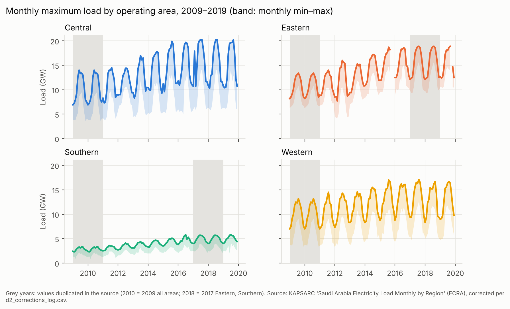
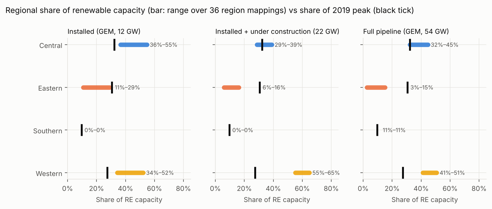
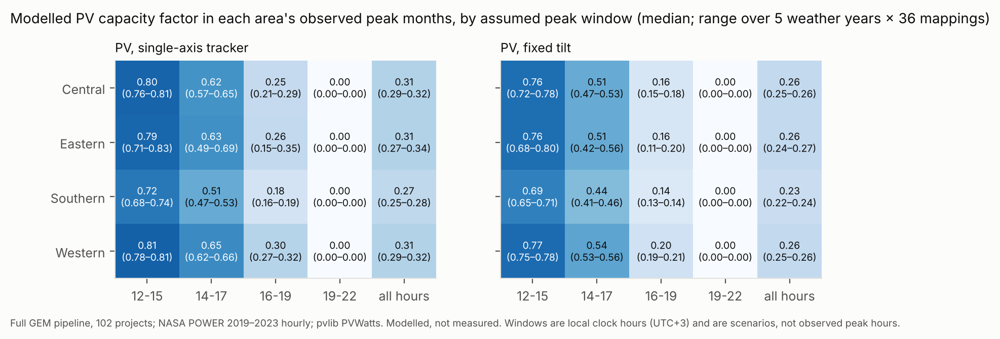
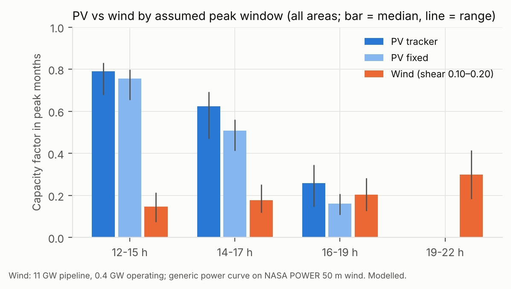

# Abstract

Assessments of renewable deployment are often stated in installed capacity, while power-system planning is constrained by where and when load peaks. This study asks what reproducible public data can establish about how Saudi Arabia's solar and wind fleet relates to regional peak load, and what they cannot. We combine KAPSARC regional statistics (monthly load by operating area, 2009–2019; annual regional peak and installed capacity, 2005–2019; regional consumption, 2005–2025) with a project-level fleet of 102 solar and wind projects from the Global Energy Monitor wiki. Generation is modelled with NASA POWER hourly weather (2019–2023) and pvlib. Results are reported across 36 assignments of provinces to operating areas, two PV mounting types and five weather years. Four findings emerge. First, the public data carry material quality problems: a label swap, two duplicated years and inconsistent months in the monthly load series, and a 2.2-fold overcount if the KAPSARC project tracker is summed without de-duplication. Second, regional peaks are nearly simultaneous; their sum matches the national peak to within 4% in every year from 2005 to 2019. The Central area was the only one whose 2019 installed capacity (16.5 GW) was below its peak (20.0 GW). Third, renewable capacity is unevenly distributed relative to peak. The Southern area has no operating or under-construction capacity against about 10% of peak, and the dissimilarity between capacity and peak shares is 0.28–0.38 for the 21.8 GW operating or under construction. Fourth, the modelled contribution in observed peak months depends far more on the unknown peak hour than on location: PV delivers about 0.7–0.8 of nameplate at 12–15 h, 0.15–0.30 at 16–19 h and none at 19–22 h. We conclude that monthly public data support statements about geography and seasonal exposure, but not about capacity credit, which requires hourly regional load that is not publicly available.

**Keywords:** Saudi Arabia; solar PV; wind; peak load; regional electricity demand; data quality; resource adequacy; reproducibility

# 1. Introduction

Saudi Arabia is expanding utility-scale solar and wind generation rapidly. Progress is usually reported as installed or contracted capacity. Capacity alone does not show whether new plants are where load is concentrated, or whether they generate when load peaks. Both questions matter for transmission planning and for the firm capacity that system planners must hold.

Detailed hourly, nodal studies of renewable integration in the Saudi system exist but rely on utility data that are not public [L12]. Capacity-expansion studies treat the firm capacity of renewables as an input assumption, and their results change materially with it [L28]. Public analyses therefore face a resolution problem: the openly available statistics are annual or monthly and regional, while capacity value is an hourly concept.

This paper makes that problem explicit. Rather than estimating a capacity credit that public data cannot support, it asks four questions:

- **RQ1:** How did monthly peak load, its seasonality and regional capacity evolve by operating area?
- **RQ2:** How does the regional distribution of the actual renewable fleet compare with the regional distribution of peak load?
- **RQ3:** What fraction of nameplate does the fleet's modelled output provide in each area's observed peak months, under explicitly assumed peak-hour windows?
- **RQ4:** Which of these claims are identifiable at annual, monthly and hourly resolution?

# 2. Literature and research gap

Regional electricity demand in Saudi Arabia is well studied on the energy side. Regional price and income elasticities, structural trends and projections to 2030 have been estimated for residential, commercial and industrial demand [L01–L04]. Regional climate sensitivity of cooling demand has been projected to 2060 [L05], and the temperature–load relationship has been documented at hourly national resolution [L13]. These studies concern energy (TWh), not regional peak (GW), and do not consider supply. A recent archive forecasts regional monthly load from the same KAPSARC series used here [L31], so regional load descriptives alone are not new.

On the supply side, siting studies optimise resource quality and land suitability [L10, L11]. Demand location enters at most indirectly. The only Saudi estimate of formal capacity value found concerns a single isolated mini-grid [L06]. National studies examine reliability and expansion with high renewable shares [L08, L09], and a capacity-expansion study shows that assumed renewable firm capacity drives cost, emissions and storage results [L28]. Precedents for relating PV to load timing use national load profiles [L18] or assume coincidence [L19].

Within the reviewed literature, no study evaluates the *actual* installed and pipeline fleet against *observed* regional peak structure with public data and states which claims that data can support. Utility-internal work almost certainly covers related ground at higher resolution [L12], so the contribution claimed here is reproducibility and resolution-awareness, not priority.

# 3. Data

| Source | Content used | Period | Licence |
|---|---|---|---|
| KAPSARC: Saudi Arabia Electricity Load Monthly by Region | max/avg/min load, 4 operating areas, GW | 2009–2019 | not stated |
| KAPSARC: Installed Capacity (Peak Load) by Region | peak, installed and available capacity, 4 areas | 2005–2019 | Public Domain |
| KAPSARC: Electricity Consumption by Sectors | regional totals, MWh | 2005–2025 | Public Domain |
| KAPSARC: national consumption, peak and capacity (GASTAT) | national peak | 1980–2019 | Public Domain |
| KAPSARC: Planned and Installed Renewables by Project | 68 records; province and city | 2019–2030 | Public Domain |
| Global Energy Monitor wiki | 106 pages, 108 phases; status, capacity, coordinates | retrieved 2026-10-18 | CC BY-NC-SA |
| Natural Earth admin-1 | 13 province polygons | v5 | public domain |
| NASA POWER hourly | GHI, DNI, DHI, T2M, WS50M at 100 coordinates | 2019–2023 | free with attribution |

All files were downloaded on 2026-10-18 and stored unmodified, with SHA-256 manifests.

## 3.1 Data-quality findings

The monthly load series contains four problems. They are corrected or flagged under documented rules.

1. **Label swap.** In all 12 months of 2011 for the Central area, the value labelled "Minimum" is the largest of the three. The values were re-assigned by sorting.
2. **Inconsistent months.** In three isolated Eastern months, min ≤ avg ≤ max is violated with no unambiguous fix. The maximum was set to missing, and a sensitivity file keeps the raw values.
3. **Duplicated years.** 2010 duplicates 2009 exactly in every area and measure; 2018 duplicates 2017 for the Eastern and Southern areas. Duplicated years are excluded from year-specific statistics and counted once in pooled statistics.
4. **Suspected outlier.** Central, February 2017: maximum 17.9 GW against an average of 8.7 GW. It is retained and flagged.

The KAPSARC renewables tracker compiles several reporting sources. Its 68 records correspond to 28 distinct projects (22.3 GW); summing every record gives 49.8 GW. Three rows are unlocated aggregates (14.4 GW), and three projects carry conflicting provinces. Only 0.7 GW is marked installed, while the GEM wiki lists 12.0 GW as operating. The GEM fleet is therefore used for RQ2–RQ3. The de-duplicated KAPSARC fleet is reported as a source-sensitivity case.

# 4. Methods

**Geography.** GEM coordinates (59 exact, 49 approximate) were assigned to provinces by point-in-polygon. One coastal point was snapped to the nearest province, 15 km away or less, and flagged. Provinces were aggregated to the four operating areas. No official list of which provinces belong to which area was found, so four ambiguous provinces were given every plausible assignment: Hail (3 options), Al-Jouf (3), Northern Borders (2) and Al-Baha (2). That gives 36 mapping scenarios, and results are reported as ranges over them.

**Indicators.**
- Growth rate: g = 100(X_t / X_{t−1} − 1). CAGR is computed over stated spans.
- Load factor: mean monthly average load divided by the annual maximum.
- Summer/winter ratio: the Jun–Sep maximum divided by the Dec–Feb maximum.
- Regional mismatch: the Duncan dissimilarity index, D = ½ Σ_r |s_r − d_r|, where s_r and d_r are area shares of renewable capacity and of the reference (2019 peak, or 2025 consumption). D is the share of capacity that would have to be located elsewhere to match the reference distribution. It says nothing about transmission adequacy.

**Generation.** PV output per kW AC uses pvlib:
- solar position;
- either a single-axis N–S tracker (±60°, backtracking, ground coverage ratio 0.35) or fixed tilt equal to latitude;
- isotropic transposition and the PVsyst cell-temperature model;
- PVWatts DC with γ = −0.35 %/K, 14% losses and a DC/AC ratio of 1.25.

Sensitivity cases use 10%/−0.30 %/K and 20%/−0.45 %/K. Wind output uses a generic normalised power curve (cut-in 3, rated 12 and cut-out 25 m/s, 12% losses) with WS50M extrapolated to a 120 m hub height, using shear exponents of 0.10 and 0.20. 93 MW of solar-thermal fields at integrated solar combined-cycle (ISCC) plants are excluded.

**Peak-window capacity factor.** For area r, window T and months M:

A[r,T,M] = Σ_p C_p · mean_{t∈T∩M}(P_p,t) / Σ_p C_p,

where P_p,t is per-kW output and C_p is capacity. The peak months M are observed: the months within 5% of each year's maximum in 2016–2019, with duplicates removed (May–Sep for Central and Western, Jun–Sep for Eastern and Southern). The windows T (12–15, 14–17, 16–19 and 19–22 h local time) are scenarios. A is a scenario quantity and is not an ELCC.

**Storage bound.** A battery that charges only from the modelled PV, discharges only within 19–22 h, has 85% round-trip efficiency and a state of charge of at least 10% gives the fraction of PV nameplate held in that window. This is a sizing bound, not a dispatch study.

**Validation.**
- V1: monthly-derived annual maxima compared with the annual regional peak table.
- V2: the sum of regional peaks compared with the national peak.
- V3: the plausibility of modelled annual capacity factors.

No Saudi plant output was available to validate against.

# 5. Results

## 5.1 Regional peak, capacity and demand (RQ1)

| Area | Peak 2005→2019 (GW) | CAGR 2005–19 | CAGR 2015–19 | Installed/peak 2019 | Consumption CAGR 2019–25 |
|---|---|---|---|---|---|
| Central | 9.1 → 20.0 | 5.8% | −0.4% | 0.82 | 4.9% |
| Eastern | 9.2 → 19.0 | 5.3% | −1.2% | 1.65 | 3.7% |
| Southern | 2.2 → 6.0 | 7.5% | +3.2% | 1.12 | 4.2% |
| Western | 8.6 → 17.0 | 5.0% | −2.2% | 1.80 | 4.1% |

- Regional peaks grew 5–7.5% a year until 2015, then plateaued. Regional consumption grew again from 2019 to 2025, at 3.7–4.9% a year.
- The Central area was the only one whose 2019 installed capacity was below its own peak, by 3.5 GW. It depends on inter-area transfers.
- The annual peak falls in July (Central, Southern) or August (Eastern, Western), as Fig. 1 shows. The median summer/winter ratio ranges from 1.31 (Southern) to 1.70 (Western).
- The sum of the four regional peaks equals the national peak to within 0–4% in every year, so the regional peaks are nearly coincident.

## 5.2 Geography of the fleet (RQ2)

The GEM fleet totals 12.0 GW operating, 9.8 GW under construction and 32.1 GW in pre-construction, excluding cancelled phases.

| Fleet | GW | D vs 2019 peak, base mapping | Range over 36 mappings | Mappings with D > 0.2 |
|---|---|---|---|---|
| Operating | 12.0 | 0.23 | 0.11–0.29 | 67% |
| Operating + under construction | 21.8 | 0.31 | 0.28–0.38 | 100% |
| Full pipeline | 54.0 | 0.20 | 0.16–0.28 | 89% |

- The Southern area holds no operating or under-construction capacity, against about 10% of peak.
- The Western area holds 55–65% of the operating and under-construction capacity, against 27% of peak.
- The Eastern area is under-represented in every set: 3–29% of capacity against 31% of peak (Fig. 2).

Using 2025 consumption as the reference gives similar values (base D = 0.22, 0.29 and 0.18). The de-duplicated KAPSARC fleet spans D = 0.10–0.31.

## 5.3 Modelled peak-season contribution (RQ3)

The modelled annual PV capacity factors are 0.19–0.30 (median 0.27 with trackers, 0.24 fixed). In each area's observed peak months, the tracker case gives the following (ranges across areas; full pipeline, medians over 5 weather years × 36 mappings):

| Window | 12–15 h | 14–17 h | 16–19 h | 19–22 h | All hours |
|---|---|---|---|---|---|
| Median capacity factor | 0.72–0.81 | 0.51–0.65 | 0.18–0.30 | 0.00 | 0.27–0.31 |

The fixed-tilt case is 0.04–0.12 lower at 14–19 h (Fig. 3).

- The Western area has a slightly higher late-afternoon factor than the Eastern area: the median difference at 16–19 h is +0.04, holding in 67% of tracker and 91% of fixed scenarios.
- The loss and temperature-coefficient sensitivity moves the 16–19 h tracker value from 0.23 to 0.28, which is small relative to the effect of the window.
- Modelled wind is evening-weighted: its median capacity factor is 0.22–0.36 at 19–22 h, its highest window (Fig. 4). Only 0.4 GW of wind is operating.
- In the storage bound, midday PV always fills the battery during peak months. The 19–22 h firm fraction therefore equals the deliverable battery energy: for example, 0.50 of nameplate with 0.5 kW × 4 h per kW of PV.

## 5.4 Validation

- **V1:** the two KAPSARC peak tables differ by a median of 3.7%, with 68% of region-years within 5%. Both derive from the regulator, so this is a consistency check, not independent validation.
- **V2:** the ratio of summed regional peaks to the national peak is 0.97–1.04.
- **V3:** no modelled PV project-year falls outside an annual capacity factor of 0.18–0.33.
- **Weather completeness:** none of the 4.4 million weather hours is missing.

# 6. Discussion

**What the data establish.**
- Regional peak and consumption trajectories.
- The Central area's capacity deficit relative to its own peak.
- The near-coincidence of regional peaks.
- The geography of the fleet and its sensitivity to province assignment.
- The months in which each area peaks.

**What they do not establish.**
- The hour of the regional peak. Without it, the modelled contribution of the same fleet ranges from about 0.8 of nameplate to zero.
- Capacity credit, reserve margins and reliability, which need hourly regional load and outage data.

The size of the window effect relative to the location effect is the central result. For planning studies that assume a renewable firm capacity [L28], the relevant uncertainty is temporal before it is spatial.

**Engineering and policy implications.**
1. Publishing hourly, or at least daily, regional peak timing would allow capacity value to be estimated reproducibly.
2. Because regional peaks coincide, geographic diversity of PV across areas does not create diversity in peak timing.
3. The concentration of new capacity in the West and its absence in the South point to inter-area transfer and to evening storage, rather than more PV, as the planning variables to examine.
4. Wind, though small, is the only modelled resource with output in the evening window.

# 7. Limitations

- The regional peak data end in 2019, while the fleet is assessed as of 2026.
- The province-to-area mapping is unverified, which is why every regional result carries 36 scenarios.
- GEM statuses are not official, and 47 entries are labelled "Assumed PV".
- Capacity units are mixed (MWac, MW, MWp).
- NASA POWER is coarse and only partly captures dust and soiling.
- No plant output is available to validate the generation model.
- The analysis is descriptive throughout and makes no causal inference.

# 8. Conclusions

Public Saudi data are sufficient to show where the renewable fleet sits relative to regional peak load, and which months matter. They are not sufficient to quantify how much of that fleet counts towards the peak. A reproducible assessment should report contribution as a function of the assumed peak hour, with geography and data-quality uncertainty propagated, rather than as a single capacity credit.

# Data availability

The KAPSARC datasets are available at datasource.kapsarc.org under the identifiers listed in `config/data_sources.yaml`. GEM wiki content (CC BY-NC-SA), Natural Earth and NASA POWER are publicly available. Derived tables are provided in `results/tables`.

# Code availability

All code, tests and the run order are provided in the accompanying repository (`docs/results_phase6_7.md` §8).

# References

Literature (IDs as in `literature/literature_matrix.csv`; checked at title, author, year, venue and DOI level from index metadata; **full texts not read**):

- [L01] Mikayilov JI, Darandary A. Modelling and projecting regional electricity demand for Saudi Arabia. *OPEC Energy Review* (2024). doi:10.1111/opec.12312
- [L02] Mikayilov JI, Alyamani R, Darandary A, Hasanov F. Modeling and forecasting industrial electricity demand for Saudi Arabia: Uncovering regional characteristics. *The Electricity Journal* (2023) 107331. doi:10.1016/j.tej.2023.107331
- [L03] Mikayilov JI, Darandary A. Commercial electricity demand modeling: Do regional differences matter for Saudi Arabia? *Energy Reports* (2023). doi:10.1016/j.egyr.2023.09.093
- [L04] Mikayilov JI, Darandary A, Alyamani R, Hasanov FJ, Alatawi H. Regional heterogeneous drivers of electricity demand in Saudi Arabia: Modeling regional residential electricity demand. *Energy Policy* 146 (2020) 111796. doi:10.1016/j.enpol.2020.111796
- [L05] Mikayilov JI, Darandary A, Alhadhrami K. The Rising Cost of Cooling: Regional Energy Futures in a Warming Saudi Arabia. KAPSARC Discussion Paper (2025). doi:10.30573/ks--2025-dp40
- [L06] Gusmao A, Groissböck M. Capacity value of photovoltaic and wind power plants in an isolated mini-grid in the Kingdom of Saudi Arabia. IEEE SASG (2015). doi:10.1109/SASG.2015.7449275
- [L08] Elshurafa AM, Felder FA, Alhaidari N. Achieving Renewable Energy Targets Without Compromising the Power Sector's Reliability. KAPSARC Discussion Paper (2022). doi:10.30573/ks--2021-dp23
- [L09] Alraddadi M, Conejo AJ, Lima RM. Expansion planning for renewable integration in power system of regions with very high solar irradiation. *J. Mod. Power Syst. Clean Energy* 9 (2021). doi:10.35833/MPCE.2019.000112
- [L10] Imam AA, Abusorrah A, Marzband M. Potentials and opportunities of solar PV and wind energy sources in Saudi Arabia. *Results in Engineering* (2024). doi:10.1016/j.rineng.2024.101785
- [L11] Elkadeem MR et al. Data-driven geospatial analysis for utility-scale solar PV siting. IEEE ICRERA (2025). doi:10.1109/icrera66237.2025.11283738
- [L12] Yasin JA et al. Technical assessment of KSA power system with large participation of renewables. IEEE SASG (2022). doi:10.1109/sasg57022.2022.10201226
- [L13] Howarth N et al. Staying cool in a warming climate: temperature, electricity and air conditioning in Saudi Arabia. *Climate* 8(1):4 (2020). doi:10.3390/cli8010004
- [L18] Awan AB, Zubair M, Praveen RP, Abo-Khalil AG. Solar energy resource analysis and evaluation of photovoltaic system performance in various regions of Saudi Arabia. *Sustainability* 10(4):1129 (2018). doi:10.3390/su10041129
- [L19] Albalawi H. Potential of rooftop PV systems on weekly peak load shaving in Saudi Arabia. *Smart Grid and Renewable Energy* 9 (2018). doi:10.4236/sgre.2018.92003
- [L28] Elshurafa AM, Petitet M, Felder FA. How firm capacity and forced outage rate assumptions of renewables impact capacity expansion model results. IEEE SASG (2022). doi:10.1109/sasg57022.2022.10199184
- [L31] Belete E. Reproducible code and data for regional electricity demand forecasting in Saudi Arabia. Zenodo (2026). doi:10.5281/zenodo.18252969

Data and methods (**verify before submission**):

- KAPSARC Energy Data Portal, datasets listed in `config/data_sources.yaml`, accessed 2026-10-18.
- Global Energy Monitor. Global Solar Power Tracker / Global Wind Power Tracker, gem.wiki, accessed 2026-10-18 (CC BY-NC-SA).
- NASA Langley Research Center POWER Project, hourly API, accessed 2026-10-18.
- Natural Earth, Admin 1 – States, Provinces (1:10m).
- Holmgren WF, Hansen CW, Mikofski MA. pvlib python: a python package for modeling solar energy systems. *J. Open Source Software* 3(29):884 (2018). doi:10.21105/joss.00884
- Duncan OD, Duncan B. A methodological analysis of segregation indexes. *American Sociological Review* 20(2):210–217 (1955). doi:10.2307/2088328

# Before submission (not part of the manuscript)

1. Read the full texts of L08, L09, L12 and L28, and confirm the gap statement.
2. Repeat the literature search in Scopus or Web of Science before making any novelty claim.
3. Verify the method and data references above against their sources.
4. Find an official province-to-operating-area mapping if one exists.
5. Check the KAPSARC licence for the monthly load series.
6. Add authors, affiliations, funding and a competing-interests statement, and format for the target journal (IET RPG, Energy Reports or Energy Strategy Reviews).
